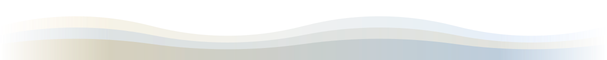

  <picture>
    <source media="(prefers-color-scheme: dark)" srcset="./assets/header-dark.svg">
    <source media="(prefers-color-scheme: light)" srcset="./assets/header-light.svg">
    
  </picture>

  <picture>
    <source media="(prefers-color-scheme: dark)" srcset="https://readme-typing-svg.demolab.com?font=Fira+Code&weight=500&size=20&pause=1800&color=F5B83D&center=true&vCenter=true&width=640&height=40&lines=Building+scalable+enterprise+applications;Designing+maintainable+architectures;Optimizing+performance+end-to-end;Exploring+AI-assisted+development">
    <source media="(prefers-color-scheme: light)" srcset="https://readme-typing-svg.demolab.com?font=Fira+Code&weight=500&size=20&pause=1800&color=9A6700&center=true&vCenter=true&width=640&height=40&lines=Building+scalable+enterprise+applications;Designing+maintainable+architectures;Optimizing+performance+end-to-end;Exploring+AI-assisted+development">
    
  </picture>

  
  
  

## About

I'm a full-stack engineer based in Guadalajara, Mexico, building production software for enterprise platforms used by thousands of people, from performant frontend applications to backend services, APIs and developer tooling.

I enjoy untangling complex problems, improving performance and designing architectures that stay maintainable as products and teams grow. Self-taught and disciplined, I do my best work in multidisciplinary teams where clear communication and critical thinking matter as much as the code.

**Right now I'm**

- Building enterprise applications across the stack, with a focus on security and performance
- Going deeper into backend architecture and system design with Node.js and Spring Boot
- Designing AI agent workflows that keep a human in the review loop

## What I Focus On

<table>
  <tr>
    <td width="50%" valign="top">
      <h4>Frontend Architecture</h4>
      React + TypeScript, Next.js App Router and Angular applications organized by feature, with deliberate state ownership (Redux Toolkit, Zustand, TanStack Query), typed forms and micro-frontend composition.
    </td>
    <td width="50%" valign="top">
      <h4>Backend &amp; APIs</h4>
      REST and GraphQL services with Node.js (Express, NestJS) and Spring Boot. Layered designs, a single error contract, JWT auth with RBAC, and data on PostgreSQL, MySQL and MongoDB.
    </td>
  </tr>
  <tr>
    <td width="50%" valign="top">
      <h4>Security &amp; Compliance</h4>
      Dependency vulnerability remediation at scale, exact pinning and reproducible installs, validation in layers (client, server, database) and server-side business logic that can't be tampered with.
    </td>
    <td width="50%" valign="top">
      <h4>Performance &amp; Quality</h4>
      Lazy loading, batching and caching on state-heavy views, backed by tests in Jest, Vitest, React Testing Library and Supertest that make refactors safe.
    </td>
  </tr>
  <tr>
    <td width="50%" valign="top">
      <h4>Real-Time Dashboards</h4>
      Live dashboards and custom data visualizations that stay responsive as data changes, built with TanStack Query, Next.js parallel routes and Web Workers.
    </td>
    <td width="50%" valign="top">
      <h4>AI-Assisted Engineering</h4>
      Claude Code workflows, agent skills and verification steps, plus shared conventions (ESLint, Prettier, Husky, GitHub Actions) that help teams ship faster and safer.
    </td>
  </tr>
</table>

## Tech Stack

<table>
  <tr>
    <td><b>Languages</b></td>
    <td>
      
      
      
      
      
      
    </td>
  </tr>
  <tr>
    <td><b>Frontend</b></td>
    <td>
      
      
      
      
      
      
      
      
      
      
    </td>
  </tr>
  <tr>
    <td><b>Backend</b></td>
    <td>
      
      
      
      
      
    </td>
  </tr>
  <tr>
    <td><b>Databases</b></td>
    <td>
      
      
      
      
      
    </td>
  </tr>
  <tr>
    <td><b>Testing</b></td>
    <td>
      
      
      
    </td>
  </tr>
  <tr>
    <td><b>DevOps &amp; Cloud</b></td>
    <td>
      <img src="https://img.shields.io/badge/AWS-21262D?style=flat-square&logo=%3D" alt="AWS">
      
      
      
      
      
    </td>
  </tr>
  <tr>
    <td><b>Tooling</b></td>
    <td>
      
      
      
      
      
      
      
    </td>
  </tr>
  <tr>
    <td><b>Libraries</b></td>
    <td>
      
      
      
      
      
      
      
      
      
      
      
      
      
      
    </td>
  </tr>
</table>

## GitHub Activity

  <picture>
    <source media="(prefers-color-scheme: dark)" srcset="https://streak-stats.demolab.com?user=RochaDiego04&border_radius=10&background=0D1117&border=30363D&stroke=30363D&ring=F5B83D&fire=F5B83D&currStreakNum=F0F6FC&sideNums=F0F6FC&currStreakLabel=F5B83D&sideLabels=8B949E&dates=6E7681">
    <source media="(prefers-color-scheme: light)" srcset="https://streak-stats.demolab.com?user=RochaDiego04&border_radius=10&background=FFFFFF&border=D0D7DE&stroke=D0D7DE&ring=BF8700&fire=BF8700&currStreakNum=1F2328&sideNums=1F2328&currStreakLabel=9A6700&sideLabels=59636E&dates=8C959F">
    
  </picture>

## Let's Connect

I'm always happy to talk about frontend architecture, scalable backends, security compliance or AI-assisted engineering. Reach me on [LinkedIn](https://www.linkedin.com/in/diego-rocha-escamilla/) or at [rochaesc04@outlook.com](mailto:rochaesc04@outlook.com).

